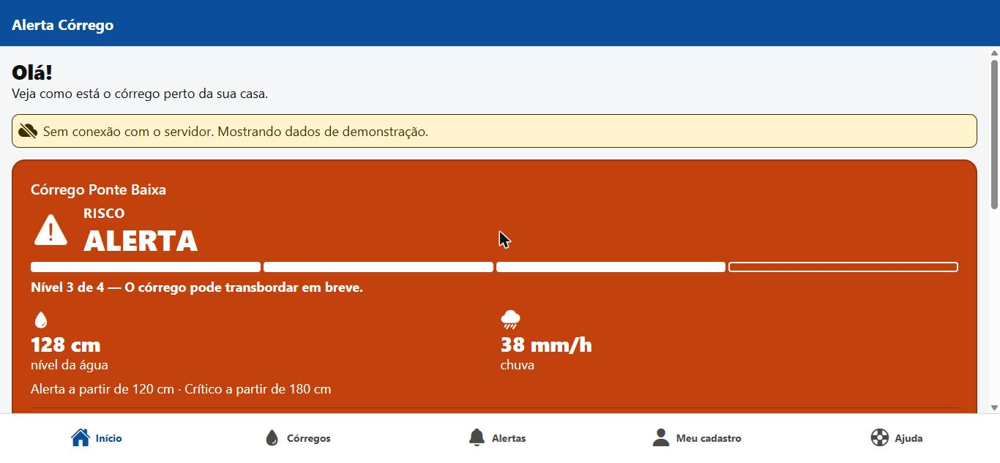
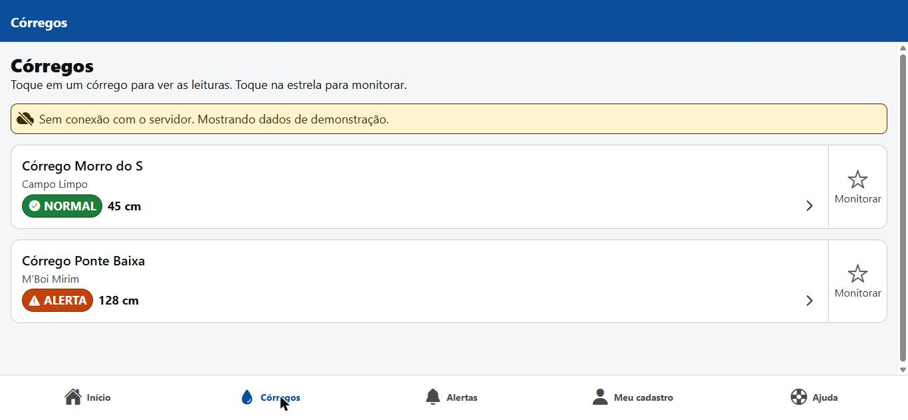
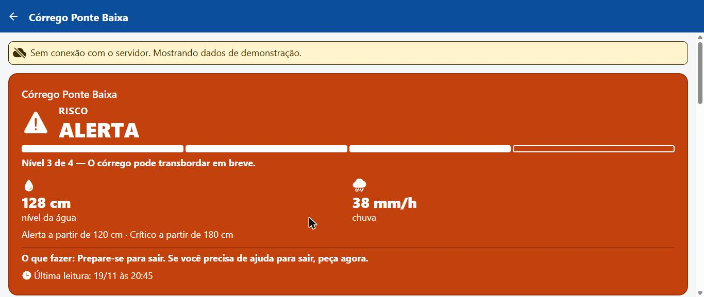
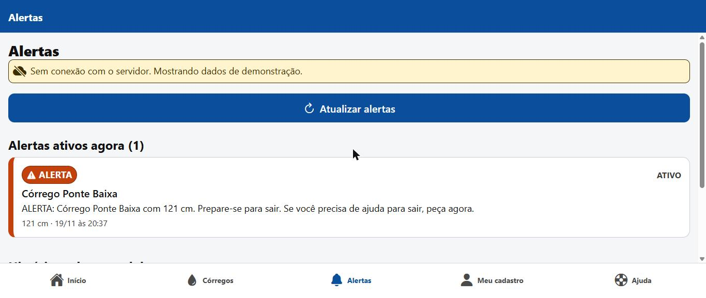
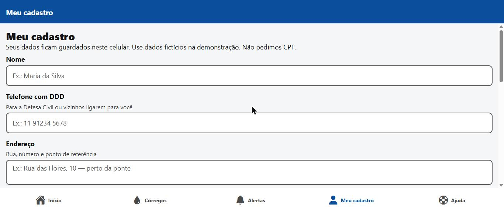
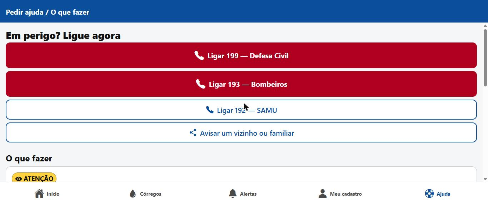

# Alerta Córrego — App Mobile (Global Solution FIAP)

## Ficha da CitizenTech — Alerta Córrego

| Campo | Preenchimento |
|---|---|
| **Nome** | Alerta Córrego |
| **Cidade e bairro** | São Paulo — região do Córrego Ponte Baixa / M'Boi Mirim (Zona Sul) |
| **Cidadão beneficiado** | Morador de área de risco de alagamento, com prioridade para idosos e pessoas com mobilidade reduzida |
| **Problema, em uma frase** | Moradores de ruas às margens de córregos pequenos, que não são monitorados pelas estações da Prefeitura, recebem alertas de chuva para a região inteira, mas não sabem quando o córrego da rua deles vai transbordar, e quem tem mobilidade reduzida depende de vizinhos para sair a tempo. |
| **Como funciona** | Um sensor no córrego (ESP32) mede o nível da água e a chuva → envia para uma API → a API classifica o risco e gera alertas → o app e o painel web mostram os alertas para os moradores cadastrados, com prioridade para quem precisa de ajuda para sair. |
| **O que cada parte faz** | **Mobile:** app do morador (ver nível/risco do córrego, receber alertas, cadastrar-se e pedir ajuda). **SOA:** API REST (Python/FastAPI) com domínio, banco, migrações, Swagger e testes. **C#:** Web API .NET com EF Core, LINQ, async e testes unitários. **QA:** features e casos de teste no Azure Boards. |
| **Link do repositório** | **Mobile (este repositório): https://github.com/fabriciomunix/GS-Mobile** · SOA: https://github.com/fabriciomunix/Gs-soa · C#: https://github.com/fabriciomunix/Gs-c- · QA: https://github.com/fabriciomunix/GS-QA |
| **Indicador de impacto** | Minutos de antecedência do alerta antes da água atingir a rua; nº de moradores prioritários alertados |
| **ODS conectados** | ODS 11 (meta 11.5 — reduzir mortes/afetados por desastres), ODS 13 (meta 13.1 — adaptação a eventos climáticos), ODS 10 (inclusão de idosos e PcD) |

### Integrantes
- Fabricio Carlos Duarte Rossi Junior — RM 555017
- Arnaldo Filho — RM 555780

---

## Descrição

O **Alerta Córrego** é o app do morador. Ele mostra, em linguagem simples, **como está o córrego da rua da pessoa** (nível da água em cm, chuva em mm/h e risco), lista os **alertas** gerados pela API, guarda um **histórico offline** no celular e permite que o morador faça o seu **cadastro**, informando se **precisa de ajuda para sair de casa** (idoso, cadeirante, acamado...). Em uma emergência, a tela **Ajuda** liga com um toque para a **Defesa Civil (199)**, **Bombeiros (193)** e **SAMU (192)** e permite avisar um vizinho/familiar com o endereço já preenchido.

### Regra de risco (igual em Mobile, SOA e C#) — `src/utils/risco.ts`

| Condição | Risco | Cor | Ícone |
|---|---|---|---|
| nível ≥ `nivelCriticoCm` | **CRÍTICO** | vermelho | alerta (círculo) |
| nível ≥ `nivelAlertaCm` | **ALERTA** | laranja | triângulo de aviso |
| nível ≥ 0,75 × `nivelAlertaCm` **ou** chuva ≥ 30 mm/h | **ATENÇÃO** | amarelo | olho |
| caso contrário | **NORMAL** | verde | check |

## Telas

| Aba / rota | O que faz |
|---|---|
| **Início** (`app/(tabs)/index.tsx`) | Cartão grande com o risco do *meu* córrego (cor + ícone + texto + barra de 4 níveis), nível em cm, chuva em mm/h, horário da última leitura e botão **Atualizar**. Se o risco for ALERTA/CRÍTICO e o morador for prioritário, mostra o atalho **Pedir ajuda agora**. |
| **Córregos** (`app/(tabs)/corregos.tsx`) | Lista de córregos com risco atual; estrela para **monitorar** (salvo no SQLite). |
| **Detalhe do córrego** (`app/corrego/[id].tsx`, pilha) | Cartão de risco, limites de alerta/crítico e **leituras recentes** com o risco de cada uma. |
| **Alertas** (`app/(tabs)/alertas.tsx`) | Alertas **ativos** (API) + **histórico salvo no celular** (SQLite, funciona sem internet). |
| **Meu cadastro** (`app/(tabs)/cadastro.tsx`) | Formulário (nome, telefone, endereço, córrego, *preciso de ajuda para sair*, tipo de necessidade). Salva no SQLite e envia para a API (`POST/PUT /api/moradores`). |
| **Ajuda** (`app/(tabs)/ajuda.tsx`) | Botões para ligar 199 / 193 / 192 (`Linking`), "Avisar um vizinho ou familiar" (`Share`) e orientações do que fazer em cada nível. |

Navegação: **Expo Router** com abas (`Tabs`) + pilha (`Stack`) para o detalhe.

## Tecnologias

- **Expo SDK 52** · React Native 0.76 · React 18.3 · **TypeScript**
- **Expo Router 4** (rotas por arquivos em `app/`)
- **expo-sqlite 15** (API assíncrona: `openDatabaseAsync`, `runAsync`, `getAllAsync`, `getFirstAsync`)
- `fetch` com **timeout** (`AbortController`) + **fallback automático para mock**
- `@expo/vector-icons` (Ionicons), `Linking` (ligações), `Share` (pedir ajuda)

## Como rodar

Pré-requisitos: Node.js 18+ (recomendado 20/22) e o app **Expo Go** (SDK 52) no celular.

```bash
npm install
cp .env.example .env      # opcional: configure a URL da API
npx expo start            # escaneie o QR Code com o Expo Go
```

> Se o Expo avisar sobre versões de pacotes, rode `npx expo install --fix`.
> Atalhos: `npm run android`, `npm run ios`, `npm run typecheck`.

### Apontar para a API (SOA ou C#)

O app consome a API REST do projeto (mesmo contrato no **SOA/FastAPI** e no **C#/.NET**). Configure no arquivo `.env`:

```env
EXPO_PUBLIC_API_URL=http://192.168.0.10:8000   # SOA (FastAPI/uvicorn)
# EXPO_PUBLIC_API_URL=http://192.168.0.10:5000 # C# (.NET)
EXPO_PUBLIC_API_TIMEOUT_MS=5000
```

- O app acrescenta **`/api`** automaticamente (ex.: `http://192.168.0.10:8000/api/corregos`).
- No celular físico use o **IP da máquina na rede Wi‑Fi**, não `localhost`. No emulador Android use `http://10.0.2.2:PORTA`.
- Suba a API escutando em todas as interfaces (ex.: `uvicorn app.main:app --host 0.0.0.0 --port 8000` / `dotnet run --urls http://0.0.0.0:5000`).
- Depois de alterar o `.env`, reinicie com `npx expo start -c`.

Endpoints usados:

| Método | Rota | Uso no app |
|---|---|---|
| GET | `/api/corregos` | lista de córregos, opções do cadastro |
| GET | `/api/corregos/{id}` | detalhe |
| GET | `/api/corregos/{id}/status` | cartão de risco (Início e Detalhe) |
| GET | `/api/leituras?corregoId=&limite=` | leituras recentes |
| GET | `/api/alertas?ativos=true&corregoId=` | alertas ativos |
| POST / PUT | `/api/moradores` · `/api/moradores/{id}` | envio do cadastro |

### Modo demonstração (fallback offline)

Se a URL estiver vazia, a API não responder dentro do tempo limite ou der erro, o app usa **automaticamente** os dados de `src/services/mock.ts` (mesmo seed da ficha: Córrego Ponte Baixa e Córrego Morro do S, sensores ESP32, 6 moradores fictícios, leituras e alertas) e mostra a faixa amarela **"Sem conexão com o servidor. Mostrando dados de demonstração."**. Após uma falha, o app espera 20 s antes de tentar a API de novo (o botão **Atualizar** tenta na hora).

No modo demonstração, cada toque em **Atualizar** simula uma nova leitura do ESP32 (NORMAL → ATENÇÃO → ALERTA → CRÍTICO → ...), aplicando a mesma regra da API (gera alerta em ALERTA/CRÍTICO). Isso permite mostrar todas as cores no vídeo.

## Banco de dados local (SQLite)

Arquivo `alerta_corrego.db`, criado em `src/database/schema.ts` com controle de versão (`PRAGMA user_version`):

| Tabela | Conteúdo |
|---|---|
| `morador` | o cadastro do próprio morador (uma linha): nome, telefone, endereço, córrego, prioritário, tipo de necessidade, id remoto |
| `corrego_favorito` | córregos monitorados (estrela) |
| `alerta_historico` | histórico de alertas recebidos (cache offline), com status ativo/encerrado |

## Estrutura de pastas

```
mobile/
├── app/                      # rotas (Expo Router)
│   ├── _layout.tsx           # Stack raiz + abertura do SQLite
│   ├── +not-found.tsx
│   ├── (tabs)/
│   │   ├── _layout.tsx       # abas
│   │   ├── index.tsx         # Início
│   │   ├── corregos.tsx      # Córregos
│   │   ├── alertas.tsx       # Alertas
│   │   ├── cadastro.tsx      # Meu cadastro
│   │   └── ajuda.tsx         # Pedir ajuda / O que fazer
│   └── corrego/[id].tsx      # Detalhe do córrego
├── src/
│   ├── components/           # Botao, Texto, CartaoRisco, SeloRisco, CampoTexto, Opcao, ...
│   ├── database/             # db.ts, schema.ts, moradorRepo, favoritosRepo, alertasRepo
│   ├── services/             # api.ts (fetch + timeout + fallback), mock.ts
│   ├── theme/                # cores, fontes, espaçamentos, área mínima de toque
│   ├── types/                # tipos de domínio (iguais à ficha)
│   └── utils/                # risco.ts (regra de risco), formatacao.ts
├── docs/prints/              # prints das telas
├── app.json · package.json · tsconfig.json · .env.example
├── prompts.md                # uso de IA
└── README.md
```

## Acessibilidade — decisões

- **Risco nunca só por cor**: cada nível tem **texto** (NORMAL/ATENÇÃO/ALERTA/CRÍTICO), **ícone** diferente e uma **barra de 4 blocos** ("nível 3 de 4").
- **Contraste forte** (WCAG AA ≥ 4,5:1): laranja e vermelho escuros com texto branco; amarelo com texto preto.
- **Fonte base 18** (títulos 24–40), todos os textos respeitam o **tamanho de fonte do sistema** (`allowFontScaling`, limite de 200% para não quebrar o layout).
- **Área de toque ≥ 48dp** (botões com 56–72dp, `hitSlop` extra), botões com ícone + texto.
- **Leitores de tela (TalkBack/VoiceOver)**: `accessibilityLabel`, `accessibilityRole` (button, radio, switch, header, alert, summary...), `accessibilityHint` e `accessibilityState` em todos os elementos interativos; o cartão de risco é lido como uma frase completa ("Córrego Ponte Baixa. Risco ALERTA, nível 3 de 4. Água a 128 centímetros...").
- **Avisos falados** após atualizar, salvar ou marcar favorito (`AccessibilityInfo.announceForAccessibility` e `accessibilityLiveRegion`).
- **Formulário**: rótulos sempre visíveis, dicas, erros em texto (não só borda vermelha) e anunciados; teclado de telefone.
- **Linguagem simples** e orientação direta do que fazer ("Saia de casa e vá para um lugar alto").
- **Funciona offline** (mock + histórico em SQLite): quem mais precisa não pode ficar sem informação.
- Dados **simulados**, sem CPF e sem dados sensíveis em log.

## Prints das telas

| Início | Córregos | Detalhe |
|---|---|---|
|  |  |  |

| Alertas | Meu cadastro | Ajuda |
|---|---|---|
|  |  |  |

## Vídeo

▶️ Demonstração (até 3 min): **[link do vídeo — preencher](https://youtu.be/PREENCHER)**

## Uso de IA

Veja [`prompts.md`](prompts.md).
